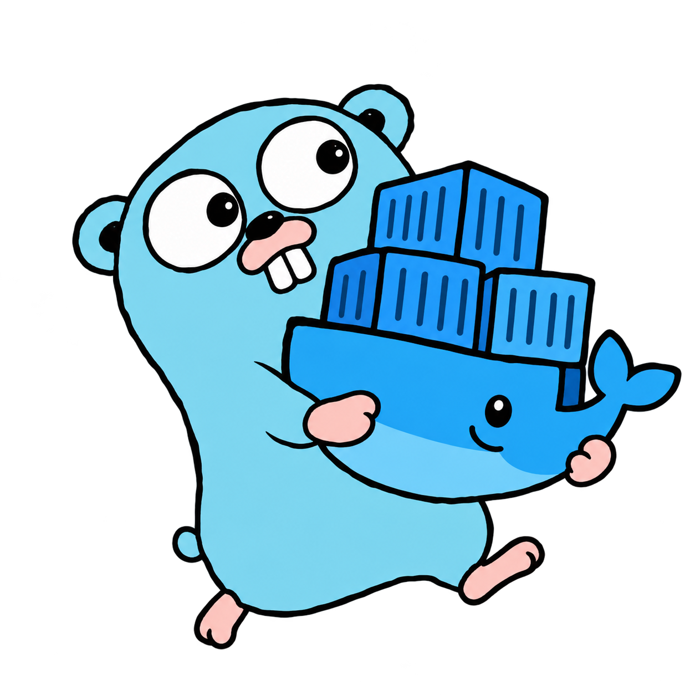

# go-dockerctl

**A Go CLI tool for managing multiple docker compose projects with SOPS encryption.**

Duplicate a Project:

- Duplicate the whole directory
- Delete .dockerctl/project.json in the newly created duplicate
    - If you do not do this the copies are considered true duplicates and any operation is blocked because dockerctl cannot distinguish
    between the projects.
- Dockerctl automatically detects it as a new project on the next operation performed on the copy

- Note that the copied project will not lose access to all encrypted secrets, i.e. they cannot be decrypted anymore
since it is a new project. So this is kind of the point. Therefore, the sops files have to be deleted, and created new as plain yaml files. They, you need to run the dockerctl encryption on this project.

- Note that the duplicate problem is only relevant per machine